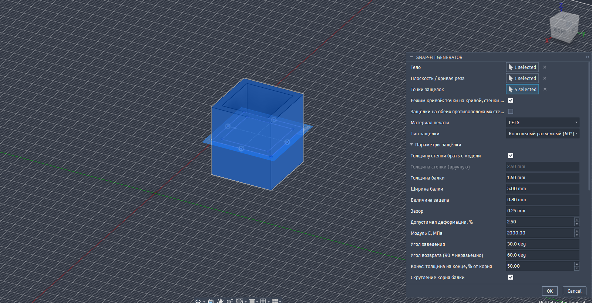
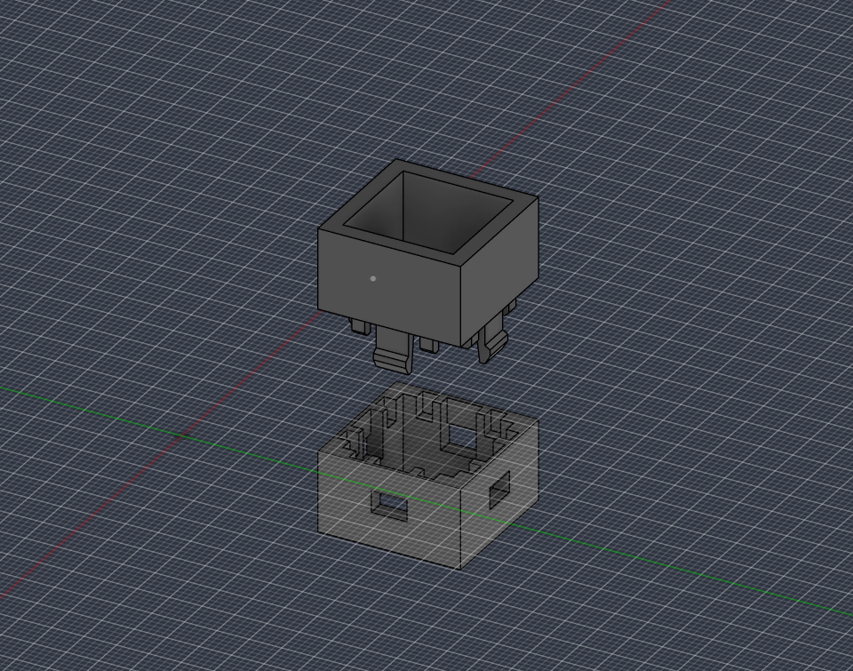
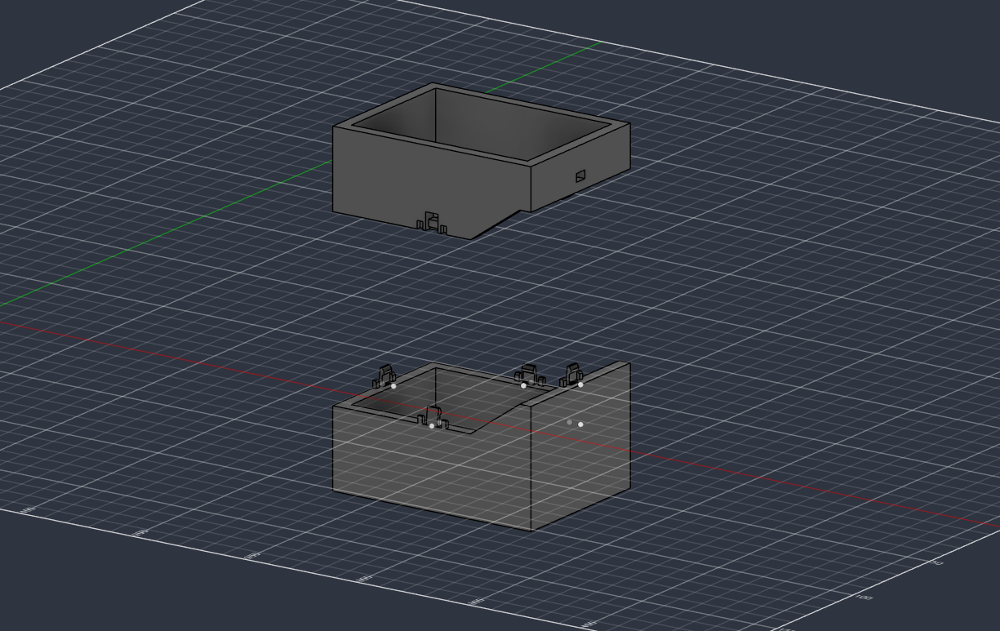

<h1 align="center"><a href="README.ru.md">🇷🇺 РУССКАЯ ВЕРСИЯ → README.ru.md</a></h1>

---

# Snap-Fit Generator for Autodesk Fusion

A Fusion add-in that splits an enclosure into two halves and automatically builds snap-fit joints for FDM printing. You pick the body, the cutting plane or curve and the snap points, and the parameters are tuned for your material: PLA, PETG, ABS, ASA or PA. Besides enclosure snaps the add-in can build a separate insert fork snap with slots cut into the bodies, and standoffs for mounting printed circuit boards on metric holes.

> Status: release 1.1.0. Cantilever, overlay, U-shaped, torsion and annular snaps, the already-split-bodies mode, timeline grouping, remembered settings and PCB standoffs have been verified manually in Fusion. The insert fork mode (new in 1.0.0) is covered only by automated checks of the logic and profiles and has not been field-tested on real models yet. Always verify the geometry with a test print.

## Features

- Splits a body with a construction plane, a face, a surface or a sketch curve.
- Cantilever snaps at any number of points: a beam with a hook on one half, a channel and a window on the other.
- Material presets: beam thickness, engagement, clearance, allowable strain, elastic modulus.
- Detachable (60° return angle) and permanent (90°) types.
- Overlay snaps for thin walls (1.2-2 mm): a straight or U-shaped beam stands inside the enclosure along the wall, and the hook enters a window in the wall of the other half.
- Torsion snaps: a lever with a hook on a square torsion bar whose ends are fixed in posts; released by pressing the hook through a window.
- Annular snaps for round parts: a collar with a bead (a body of revolution) and an annular groove; the collar is cut into fingers so the ring can be printed and assembled.
- Already-split-bodies mode: no cut, you select two existing bodies and points on one of them.
- Insert fork snap: a separate part with two arms and hooks, and the add-in cuts slots for it in one or two bodies (a wall or a stack of two walls).
- PCB standoffs: a split pin with a conical head for M2-M5 metric holes and a collar for the board. Two variants: the post is printed with the enclosure, or a blind hole is made in the body and the post is built as a separate body to be glued in.
- The beam grows on the half where the selected point lies; the “Reverse” button swaps the halves.
- Tapered beam (narrowing towards the tip) and a root fillet to reduce stress concentration.
- Guide pins on the sides of the beam to align the halves.
- Automatic wall thickness measurement from the model.
- Calculation in the dialog: beam length, strain, snap-in and release forces, warnings.
- All add-in operations are collapsed into a single “Snap-Fit” group on the timeline; on an error the add-in rolls back its steps.
- The dialog remembers the mode, material, toggles and parameters between runs; there is a reset to factory settings.
- English and Russian interface and messages (chosen automatically or manually).

## Installation

1. Copy the `SnapFitGenerator` folder into the Fusion add-ins folder:
   - Windows: `C:\Users\Username\AppData\Roaming\Autodesk\FusionAddins`
   - macOS: `~/Library/Application Support/Autodesk/Autodesk Fusion 360/API/AddIns`
2. In Fusion press **Shift+S** (Scripts and Add-Ins) and open the **Add-Ins** tab. If the add-in is not in the list, add it with the `+` button → *Script or add-in from device*.
3. Switch on the **Run** toggle (and **Run on Startup** if you want).
4. The **Snap-Fit Generator** button appears in **SOLID → CREATE** (at the very bottom of the menu). You can also find it with the command search (the `S` key).

Do not add the same add-in from two places: duplicates would appear in the list.

## Usage

1. Open a document in design-history mode (Parametric). The body must be in the root component.
2. Start the command and select:
   - **Body** - the enclosure you want to cut.
   - **Cutting plane / curve** - a construction plane, a face, a surface or a sketch curve. A curve is extruded perpendicular to the sketch plane and cuts the body.
   - **Snap points** - sketch points, construction points or vertices. Place them on the **outer surface of the wall at the cut**.
3. Choose the **material** and the **snap type**. The other parameters can be edited by hand.
4. Press OK. The body is split, a beam with a hook grows on one half and a channel and a window appear on the other.

The beam grows on the half where the selected point lies (taking into account the position of the point relative to the cut line), and the window appears on the other half. If a point lies exactly on the cut line the side cannot be determined and the direction of the cut normal is used. If the beam grew on the wrong half, enable “Reverse”.


### “Bodies are already split” mode

For an enclosure that is already cut or modeled as two parts.

1. In the **Mode** list choose “Bodies are already split (select two bodies)”.
2. Select the **Body** and the **Second body** (in any order).
3. Select the **snap points** on the surface of one of the bodies, at the edge of the joint. The beam grows on the body on whose surface the point lies and the window is made on the second one. If a point belongs to both bodies (it lies on their common edge), the beam is built on the first selected body.
4. Press OK. No cut is made, only the snaps are built.

The bodies must touch each other (or be close together) at the snap, and the outer surfaces of the walls must lie in one plane. Both bodies must be in the same component.

### Torsion snaps

Choose a “Torsion …” type; everything else is as for a beam: the body, a cutting plane or curve, and points on the wall (or two ready bodies and points).

A lever with a hook sits on a square rod (the torsion bar) that runs along the wall; the ends of the rod are fixed in two posts on its own half. The hook enters a window in the other half and is released by pressing it through the window (with a pin or a screwdriver): the rod twists and lets the hook go. The free length of the torsion bar is calculated from the allowable strain; the total length of the mechanism along the wall is shown in the “Calculation” block (usually 15-27 mm).

- An empty cavity is needed inside the enclosure along the wall: about the lever thickness plus 2 mm deep and the whole mechanism length along the wall. Ribs and bosses in this zone get in the way.
- “Lever thickness = torsion bar side” sets both the lever thickness and the side of the square torsion bar; “Lever width” is the width of the lever along the wall.
- The window in the other half is better made through: the snap is released through it.

### Annular snaps

For round enclosures, caps and lids. A collar with an annular bead (a body of revolution) enters an annular groove of the other half. Choose an “Annular …” type: instead of points the **Annular edge on the seam** field appears.

1. Select a circular edge (a full circle) on the outer cylindrical surface of the enclosure. The ring axis and radius are taken from it.
2. In cut mode you need a **plane or a flat face** for the cut (not a curve) perpendicular to the ring axis. The edge can lie anywhere on the cylinder, for example on the top rim: the seam is found as the intersection of the axis with the cutting plane. The collar grows on the half where the edge lies.
3. In the already-split-bodies mode the edge must lie on the seam between the two bodies; the collar grows on the first selected body.
4. “Reverse” swaps the halves.
5. **Slots in the collar**: a solid ring (0) is too stiff for printing and the rim strain y/r is usually above the allowable value, so by default the collar is cut into 8 fingers. The smaller the radius, the fewer slots are needed. The dialog shows the finger width and warns if it is below 3 mm or above 25 mm.
6. The groove is always blind (a through one would cut the part): the “in the wall” type needs a wall of about 4.5 mm or more, the overlay type about 2 mm or more.

You can select several rings on one seam. Guide pins are not built in annular mode: the ring centers itself.

### Insert fork snap

A mode for the case when the snap must be printed separately (from another material, in another orientation) and inserted into the enclosure. The fork looks like a two-legged pin: the head stays outside, two arms with hooks pass through a slot in a wall (or through two walls in a row, for example the lip of a lid and the wall of the base) and snap behind it.

1. In the **Mode** list choose “Insert fork snap (separate part + slots in the bodies)”.
2. Select the **Body** (the first in the stack; the points lie on its outer surface) and, if there are two walls, the **Second body in the stack**. The second body is optional.
3. Select the **Fork points** on the outer surface of the first body. A point may lie within 3 mm of the surface.
4. Press OK. At every point a separate “Snap pin N” body appears (in its working position) and a slot is cut in all selected bodies that are in the stack.

Fork parameters: stack thickness (from the model: a ray goes from the point inward through the consecutive walls of the selected bodies; or manual), arm thickness, fork width, hook overlap, slot clearance, arm length (calculated or manual), head thickness and head overhang past the slot, lead-in and return angles. “Rotate the fork by 90°” changes the direction in which the arms bend: by default they bend along the world Z axis, in the plane of the wall (along X if the wall is horizontal).

- The arm length is calculated from the allowable strain, so on a thin wall the arm root ends up above the surface and the head is tall. If it is taller than 6 mm a warning appears in the calculation: use a more flexible material, a smaller engagement or a thicker stack.
- Free space is needed behind the stack: the “Calculation” block shows how much (arm tips and hooks).
- To print the fork, move the “Snap pin” body aside or export it separately. The arms bend in the profile plane, so lay the fork on the bed on its side: the profile (the “fork” view) must lie in the plane of the layers.

### PCB standoffs

A split pin with a conical head goes into a metric hole of the board, the board sits on the collar and the hooks snap over it.

1. In the **Mode** list choose “PCB standoffs (pins for metric holes)”.
2. Select the **Enclosure body** and the **Standoff centers**: points on the body surface (for example on the floor of the enclosure) where the holes of the board will be. Sketch points, construction points and vertices work.
3. Choose the **Hole in the board**: M2, M2.5, M3, M4, M5 (diameters 2.2, 2.7, 3.2, 4.3, 5.3 mm) or “Custom diameter”.
4. Set the **board thickness** (1.6 mm by default). By default the add-in chooses the **standoff height** itself: the smallest height at which the pin strain does not exceed the allowable value for the material. You can switch the toggle off and enter it by hand.
5. Choose the **variant** and press OK.

Variants:

- **Post in the body (printed with the enclosure).** The standoff with the collar and the pin is joined to the enclosure body.
- **Hole in the body + separate post (glued in).** A blind hole for the glue-in peg is made in the body (peg diameter plus clearance) and the post is built as a separate “PCB post N” body with a peg at the bottom. The add-in measures the wall thickness under the post from the model (or takes it from the field) and limits the length of the glue-in peg so that it does not cut through the wall.

Other parameters: collar diameter and height under the board (0 = default diameter: the hole plus 3 mm), hook overlap, pin slot width (0 = auto, not less than twice the overlap plus 0.3 mm), pin clearance in the hole, allowable strain, modulus E, lead-in and return angles, “Rotate the slot by 90°”.

- The dialog shows the flexible length of the pin, the length required for the allowable strain, the board insertion force and the removal force. If the pin is too thin (halves thinner than 0.8 mm, which happens with M2) or the strain is above the allowable value, a warning appears.
- The surface under the post must be flat within the collar diameter; on a curved surface the collar would hang in the air.
- Print the separate-variant post lying on its side: the layers run along the pin and the halves bend along the layers. A post printed standing together with the enclosure breaks more easily: for that variant PETG or nylon and a taller standoff are better.

### Curve mode

1. Draw a sketch with the cut line on a plane perpendicular to the direction along which you want to cut (the line is extruded perpendicular to the sketch through the whole body). The line may consist of several segments and arcs: select them all (like the tools in Split Body) or select one and Fusion will pick up the connected chain itself.
2. Place points (sketch points) on the same curve at the places where snaps are needed.
3. In the dialog select the body, the curve and the points. The **“Curve mode”** toggle is on by default: from every point the add-in goes perpendicular to the sketch plane and finds the outer wall of the body (for a hollow enclosure the farthest intersection is taken, that is the outer surface). Of the two directions the nearest wall is chosen; the **“Snaps on both opposite walls”** toggle builds snaps on both at once.
4. Points that already lie on a wall (within 0.5 mm) are left as they are.

Limitations of the mode: on enclosures with internal ribs and partitions the “farthest intersection” may land in the wrong place; then put the points directly on the outer wall and switch the mode off.

### Interface language

The add-in shows the dialog and messages in English or Russian. The language is chosen when the add-in starts, in this order:

1. The **Language / Язык** field at the bottom of the dialog: `Auto` (default), `English` or `Русский`. The choice is saved when you press OK and takes effect after the add-in restarts (switch it off and on in the Scripts and Add-Ins window, or restart Fusion).
2. With `Auto`: Russian if the Fusion or Windows interface language is Russian, otherwise English.

The names of the modes, snap types and list items depend on the language, so after switching the language those saved values revert to their defaults. The other settings are kept.

### Remembered settings and reset

After you press OK the add-in remembers the mode, material, snap type, all toggles (including “Reverse”) and parameter values and restores them the next time it runs. The selection of bodies, curves and points is not saved. The settings are stored in the file `~/.snapfit_generator/settings.json` (on Windows: `C:\Users\<name>\.snapfit_generator\settings.json`).

To return to the factory values tick the **“Reset settings to factory defaults”** checkbox: the fields immediately take their default values and the settings file is deleted. A broken file or a file from another version is ignored.

### Parameters

| Parameter | What it does |
|---|---|
| Mode | “Cut the body” (plane or curve), “Bodies are already split” (two ready bodies), “Insert fork snap” or “PCB standoffs” |
| Snap type | Cantilever (inside the wall) or overlay (inside the enclosure along the wall), straight or U-shaped, torsion, annular; detachable or permanent |
| Annular edge on the seam | Annular types only (instead of points): the circular edge the axis and radius are taken from |
| Slots in the collar | Annular types only: the number of fingers (0 = solid ring) |
| Slot width | Annular types only |
| Take wall thickness from the model | Measures the wall with a ray from the outer point inward. Switch it off to enter the value by hand |
| Wall thickness (manual) | Used if automatic measurement is off or failed |
| Beam thickness | Thickness at the root. A multiple of the nozzle line width |
| Beam width | Width along the wall. At least 5 mm is recommended |
| Engagement | Hook height, equal to the beam deflection when snapping in |
| Clearance | Clearance between the beam and the cut-out in the other half |
| Allowable strain, % | Determines the beam length |
| Modulus E, MPa | For estimating forces (the value for loading along the layers) |
| Lead-in angle | Bevel of the hook on the entry side |
| Return angle | 90° - permanent, 45-70° - detachable |
| Taper | Beam tip thickness as a percentage of the root (100 = no taper) |
| Root fillet | A fillet of up to 0.5 of the thickness if the wall allows |
| Guide pins | Two pins on the sides of the beam with sockets in the other half |
| Beam length by calculation | Switch it off to set the length by hand |
| Through window | The window goes through the whole wall. A blind window needs a thick wall |
| Reverse: beam on the other half | Swaps the roles of the halves: the beam grows on the side opposite to the selected point |

### Fork parameters

| Parameter | What it does |
|---|---|
| Take stack thickness from the model | A ray from the point inward passes the consecutive walls of the selected bodies and measures the stack thickness |
| Stack thickness (manual) | Used if automatic measurement is off or failed |
| Arm thickness | Thickness of each of the two arms |
| Fork width | Width along the slot |
| Hook overlap | How far the hook protrudes past the edge of the slot: it holds the stack and equals the arm deflection on insertion (together with the clearance) |
| Slot clearance | Clearance between the fork and the walls of the slot |
| Arm length by calculation | Switch it off to set the length by hand |
| Head thickness, head overhang | The outer head covers the slot and keeps the fork from falling through |
| Rotate the fork by 90° | Changes the direction in which the arms bend |

### PCB standoff parameters

| Parameter | What it does |
|---|---|
| Hole in the board | M2, M2.5, M3, M4, M5 or a custom diameter |
| Board thickness | Thickness of the printed circuit board, 1.6 mm by default |
| Board standoff height above the body | Chosen by calculation or set by hand |
| Collar diameter | The support under the board; 0 = the hole plus 3 mm |
| Collar height under the board | Above the collar the pin bends, below it there is a thin neck |
| Hook overlap | How far the hook protrudes past the edge of the board hole |
| Slot width | The slot splits the pin into two halves; 0 = auto |
| Pin clearance in the hole | Diametral clearance |
| Variant | Post in the body or a separate post to be glued in |
| Glue-in peg diameter and length | Separate post only |
| Wall thickness under the standoff | Separate post only: limits the length of the glue-in peg |
| Rotate the slot by 90° | Changes the direction of the slot |

## Snap types

| Type | Description | Status |
|---|---|---|
| Cantilever, detachable (60°) | A beam with a hook inside the wall thickness; opens without breaking. Enclosures, battery compartments, service covers. Needs a wall of about 2.5 mm or more | Available |
| Cantilever, permanent (90°) | Same, but it cannot be opened without pressing the beam aside or breaking it | Available |
| Overlay for thin walls, detachable (60°) | The beam stands inside the enclosure along the wall (not in the wall thickness), the hook enters a window in the wall of the other half. For walls of 1.2-2 mm. Takes about 2 mm into the enclosure | Available |
| Overlay for thin walls, permanent (90°) | Same, but with a 90° return angle | Available |
| U-shaped overlay, detachable (60°) | The beam is folded into a U: large deflection over a short length. Takes about 4.5 mm into the enclosure. Length and forces are approximate | Available |
| Torsion overlay, detachable (60°) | A lever with a hook on a square torsion bar fixed in posts. The hook is released by pressing it through the window. Compact into the enclosure but longer along the wall | Available |
| Torsion with button, permanent (90°) | Same, but with a 90° return angle: it holds firmly and is opened by pressing the hook through the window | Available |
| Annular in the wall, detachable (60°) | For round parts: a collar with a bead enters a groove, cut into fingers. Needs a wall of about 4.5 mm or more | Available |
| Annular in the wall, permanent (90°) | Same, but with a 90° return angle: it cannot be taken apart without damage; without slots it can be airtight | Available |
| Annular overlay, detachable (60°) | The collar stands inside the enclosure along the wall, the bead enters a groove on the inner side of the wall. For walls of about 2 mm or more | Available |

## How it is calculated

- The length of a cantilever with a linear taper is calculated from the allowable root strain: `eps = t * y / (2 * K1 * L^2)`, where `t` is the thickness at the root, `y` the engagement and `K1` the beam shape integral (for a constant section `K1 = 1/3` and the formula reduces to `L = sqrt(1.5 * t * y / eps)`). For a taper down to 50% the coefficient is 1.09 instead of 0.67 for a constant-section beam (a beam with such a taper allows about 1.6 times the deflection at the same length).
- The force at the beam tip at deflection `y`: `P = E * w * t^3 * y / (12 * K1 * L^3)`.
- The snap-in and release forces are calculated from the ramp angle and a friction coefficient of 0.3: `F = P * (mu + tan(a)) / (1 - mu * tan(a))`.
- A U-shaped beam is calculated as two cantilevers in a row: the equivalent length is the leg length multiplied by the square root of two (an approximate estimate).
- Torsion: the lever rotates by the angle `theta = y / La`, where `La` is the arm from the torsion axis to the hook. For a square torsion bar of side `a` the maximum shear strain is `gamma = 0.678 * a * theta / Lh`, and the allowable one is `(1 + nu) * eps_allowable` (`nu = 0.4`, an estimate). The free length of each half `Lh` is chosen from this condition; the halves work in parallel: `M = 2 * G * J * theta / Lh`, `J = 0.1406 * a^4`, `G = E / (2 * (1 + nu))`, the force at the hook `F = M / La`. The deflection of the lever itself is checked separately.
- Ring: for a solid collar the rim strain is `eps = y / r` (`r` is the mean radius of the collar), the radial force is `2 * pi * E * y * t * w / r` (`w` is the contact width along the lead-in bevel). With slots every finger of width `(2 * pi * r - N * b) / N` is calculated as a cantilever. The stiffness of the finger arc itself is not taken into account: the estimate is conservative for deflection but approximate for forces.
- Fork: each arm is calculated as a constant-section cantilever. The deflection on insertion is `h = overlap + clearance`, the strain is `eps = 1.5 * t * h / L^2`, the force on an arm is `E * w * t^3 * h / (4 * L^3)`, and the insertion and removal forces are calculated from the ramp angles, as for a beam, for two arms.
- PCB standoff: each half of the pin is a circle segment minus the slot. The moment of inertia `I` and the distance `c` to the farthest fiber are computed numerically, the strain is `eps = 3 * y * c / L^2` (`y` is the hook overlap), the force is `3 * E * I * y / L^3` per half. The flexible length `L` is the thin neck plus the section above the collar up to the tip of the hook (the collar is considered rigid).
- The allowable strain per material is about 10-15% of the elongation at break, to leave a margin for weak interlayer adhesion and fatigue.

This is an engineering estimate to start from, not a strength calculation. Make a test print and tune the parameters for your printer.

## Material presets (starting values)

| Material | Beam, mm | Engagement, mm | Fork and pin hook, mm | Clearance, mm | Strain, % |
|---|---|---|---|---|---|
| PLA | 1.2 | 0.6 | 0.30 | 0.20 | 1.0 |
| PETG | 1.6 | 0.8 | 0.40 | 0.25 | 2.5 |
| ABS / ASA | 1.6 | 0.8 | 0.35 | 0.30 | 1.5 |
| PA (nylon) | 1.6 | 1.0 | 0.50 | 0.30 | 4.0 |

## Printing tips

- Print the beam **flat** so that it bends along the layers. A vertical beam (along the Z axis) delaminates at the root. If the cut is horizontal and the half is printed standing, the beam will run along Z: print the half on its side, make a vertical cut or choose another snap type.
- Avoid supports under the beam: their marks become a source of cracks.
- PLA is brittle and creeps under constant load. For repeated opening PETG or ABS is better.
- Load the beam only during assembly. In the assembled state it should not stay bent permanently.
- The beam thickness at the tip should be at least 0.8 mm (two lines with a 0.4 mm nozzle).
- Print an annular snap with the ring axis along Z: the layers then run around the circumference and the collar stretches along the layers, not across them. It is better to avoid supports under the bead by using the lead-in bevel.
- Print the torsion bar so that the rod axis lies in the plane of the layers (the rod along the bed): twisting along the layers is tolerated much better than with a vertical rod.
- Print the fork and the glue-in post lying on their side so that the arms bend along the layers.
- If the snap fits tightly, increase the clearance (recommendations of up to 0.4-0.5 mm exist for FDM).

## Limitations

- Works only with bodies of the root component and in history mode.
- Pins and the beam are offset along a straight line along the wall: check the result on strongly curved walls.
- The automatic wall measurement casts a ray from the outer point perpendicular to the surface. On complex internal edges or ribs it may give a wrong result: check the message after the build and enter the value by hand if needed.
- The cutting curve is extruded into a surface perpendicular to the sketch. If that did not work, create the surface manually and select its face.
- The created snaps are not parametric as a single object. To change the dimensions delete the “Snap-Fit” group on the timeline (or press Ctrl+Z right after the build) and build again. The individual operations inside the group can be expanded and edited.
- Overlay types take up space inside the enclosure along the wall: check that there are no ribs, bosses or other parts there.
- Annular types: you need a plane or a flat cutting face and a circular edge (a full circle, not an arc); the collar is built as a full body of revolution with slots cut by flat cuts, so for very narrow fingers on a small radius the shape is approximate. With several rings the dialog shows the calculation of the first one.
- The torsion type needs an empty cavity along the wall for the whole length of the mechanism and does not suit places with ribs and bosses.
- In the already-split-bodies mode the bodies must be in the same component and touch each other (or be close together) at the snap.
- The fork and the standoffs are built perpendicular to the nearest body surface at the point: the surface must be flat over the size of the fork head or the standoff collar. The second body of the fork must lie right behind the first and have the same slot axis.
- The fork and the standoff are created in their working position as separate bodies and are not updated when the enclosure changes: to recalculate, delete the “Snap-Fit” group on the timeline and build again.
- The metric holes of the board are set by diameter, not picked on a board model.

## Troubleshooting

- **The OK button is inactive.** Required objects are not selected. Beam and torsion types need a body, a cutting plane or curve (two bodies in the already-split mode) and at least one point. Annular types need a body, a plane or a second body and at least one circular edge; points are not needed. The fork and standoff modes need a body and at least one point.
- **There is no button.** It is in SOLID → CREATE at the bottom of the menu. Check that the add-in is running and that there is no duplicate in the list.
- **`Environment is not supported`.** The document is in no-history mode. Switch on Capture Design History.
- **The beam or window ended up on the wrong half.** Enable “Reverse”. If a point lies exactly on the cut line the side cannot be determined from the point.
- **“The ring does not lie on the outer cylindrical surface”.** The selected edge does not match the outer surface of the enclosure at the seam in radius: select an edge on the cylinder itself (not on a chamfer or the inner surface).
- **“The ring axis is not perpendicular to the cutting plane”.** The cutting plane must be perpendicular to the ring axis.
- **“Point N: there is no material of the first body under it”.** For the fork the point must lie on the outer surface of the selected body (or within 3 mm of it) and there must be a wall under it.
- **“Point N: the second body is not in the stack”.** This is a note, not an error: the slot was cut only in the first body. Check that the second body lies right under the first.
- **The standoff warning “Strain exceeds the allowed value”.** Increase the standoff height (or switch on the automatic height), reduce the hook overlap or use a material with a higher allowable strain (PETG, nylon).
- **“Fusion could not perform the Revolve of the profile”.** The collar or the standoff is built by revolving a profile. If the error repeats, send the full text of the message and the dimensions of the body (edge radius, wall thickness): most likely the collar does not fit into the wall.
- **An error while building the snap.** Copy the text from the error window and open an issue describing the model.

## Structure

```
SnapFitGenerator/
  SnapFitGenerator.py        # Fusion: dialog, cut, building the bodies
  snapfit_core.py            # pure math and profiles (no Fusion API), language selection
  snapfit_en.py              # English translation of the strings
  SnapFitGenerator.manifest  # add-in manifest
```

## Translating to another language

All strings in the code are written in Russian and wrapped in `tr("...")`. A translation is the `EN` dictionary in `snapfit_en.py`: the key is the Russian string, the value is the translation. To add a language copy `snapfit_en.py` (for example to `snapfit_de.py`), translate the values (leave `%s`, `%d`, `%.1f` and `%%` as they are), then add the language to `detect_language()` and to the `Language / Язык` selection list in `snapfit_core.py` and `SnapFitGenerator.py`. Wrap new strings in the code with `tr()` and add them to the dictionary: if a translation is missing, the Russian original is shown.

## Sources

- [Hubs: Design snap-fit joints for 3D printing](https://www.hubs.com/knowledge-base/how-design-snap-fit-joints-3d-printing)
- [Sovol: 3D printed snap-fit joints](https://www.sovol3d.com/blogs/news/3d-printed-snap-fit-joints-how-to-design-clips-that-work)
- [Hackaday: Oh Snap! 3D printing snapping parts without breakage](https://hackaday.com/tag/snap-fit)

## License

This project is distributed under the **Mozilla Public License 2.0 (MPL-2.0)**.
See the [LICENSE](LICENSE) file for details.
